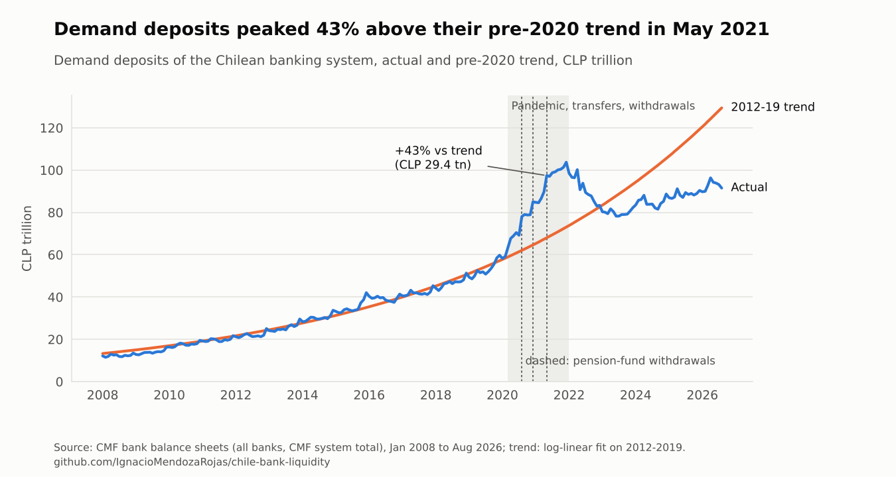
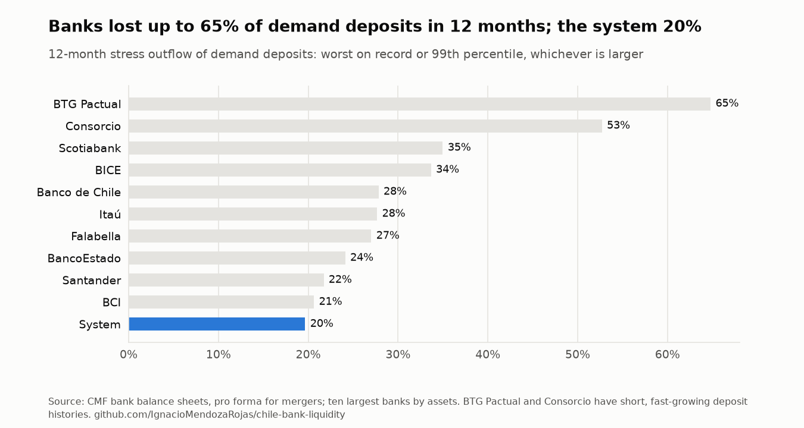
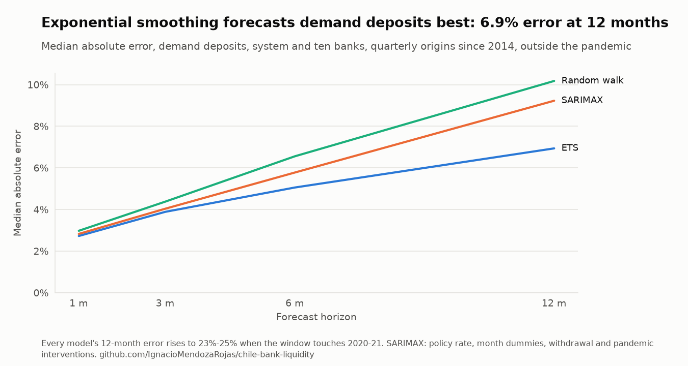
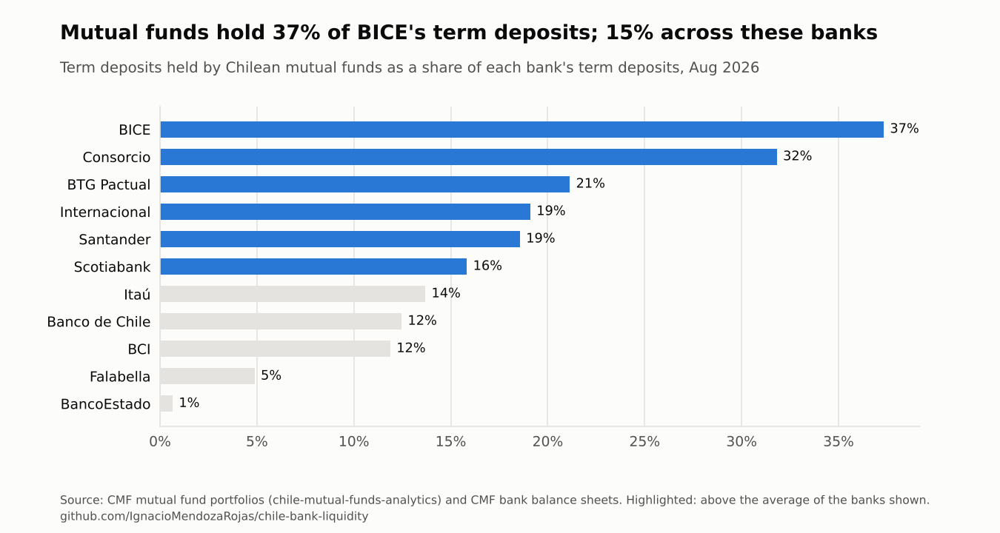
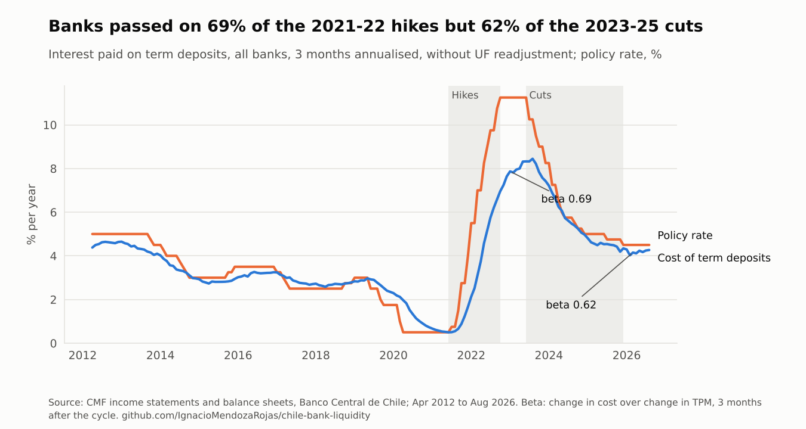
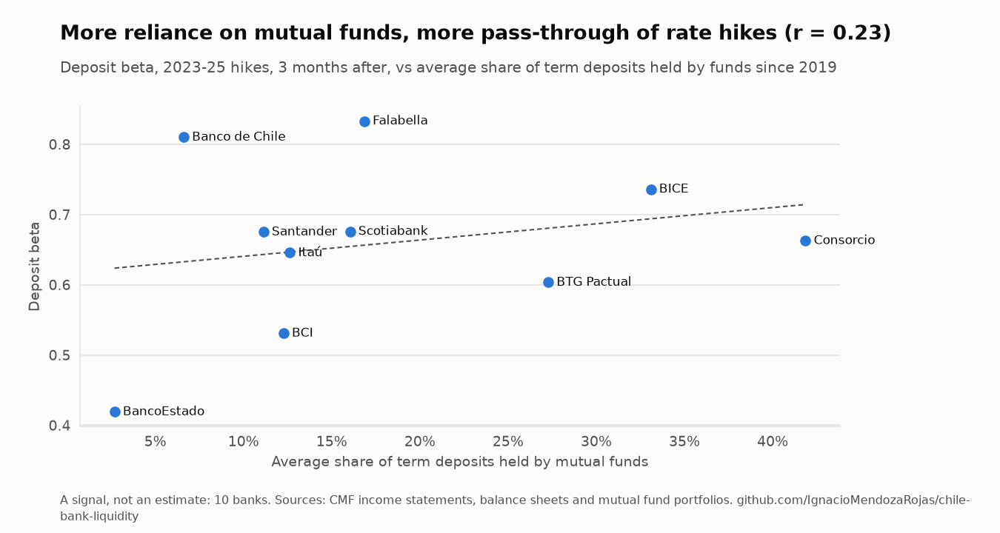

# chile-bank-liquidity

[](https://github.com/IgnacioMendozaRojas/chile-bank-liquidity/actions/workflows/ci.yml)
[](https://github.com/IgnacioMendozaRojas/chile-bank-liquidity/actions/workflows/data.yml)
[](https://github.com/IgnacioMendozaRojas/chile-bank-liquidity/actions/workflows/model.yml)

**Liquidity risk: deposit stability, stress outflows, deposit forecasting and the cost of funding.** Every Chilean bank's balance sheet and income statement since 2008, from the CMF API, used to answer the questions a liquidity-risk team answers for its own bank: how much of the deposit base is stable, how much could leave under stress, how well balances can be forecast, who provides the funding, and how fast a rate move reaches its cost.

> At Banco Ripley I work on liquidity risk (deposit balance decay, ILAAP projections under Basel III, cash-flow stress tests). This repository applies the same methods to public data for the banking system and the ten largest banks. No bank data, models or parameters are used.

## Results

- **The pandemic surge was not stable money.** Demand deposits peaked 43% above their pre-2020 trend in May 2021 (CLP 29 trillion of excess), helped by the pension-fund withdrawals. The worst 12-month outflow on record came after it, in 2022, when rate hikes pulled money into term deposits: 20% for the system and 21% to 65% by bank.
- **Simple beats complex for forecasting.** Out of sample since 2014, damped seasonal exponential smoothing misses demand deposits by a median 6.9% at 12 months, against 9.1% for SARIMAX with the policy rate and 10.2% for a random walk. No model anticipated 2020-21: errors reach 23-25% in windows that touch it.
- **Funding from mutual funds is concentrated and rate-sensitive.** Mutual funds hold 15% of the term deposits of the banks shown (37% at BICE) and withdrew 63% of their bank deposits in 12 months in 2021-22. Banks passed 69% of the 2021-22 rate hikes on to the cost of their term deposits, and banks that rely more on funds passed on more (correlation 0.45 across 10 banks).

<picture>
  <source media="(prefers-color-scheme: dark)" srcset="docs/figures/surge-dark.png">
  
</picture>

## What this shows

| Task in a liquidity-risk team | Where it is done here |
|---|---|
| Build a clean monthly history from regulatory data | CMF API, both charts of accounts (2008-2021 and 2022+) mapped to one set of items ([`accounts.py`](src/liquidity/accounts.py), [`data.py`](src/liquidity/data.py)) |
| Reconcile against an independent source | Sum of banks vs the CMF system total and vs Banco Central monetary aggregates ([`checks.py`](src/liquidity/checks.py)) |
| Handle mergers in time series | Mergers detected from the data and folded into pro-forma histories (Corpbanca into Itaú, BBVA into Scotiabank, Security into BICE) |
| Calibrate run-off and the stable core of deposits | Worst and 99% outflows at 1, 3 and 12 months, core deposits, decay curves and half-lives, with and without the pandemic ([`deposits.py`](src/liquidity/deposits.py)) |
| Backtest a stress calibration | Outflows calibrated to 2019 and to 2021, checked against what happened next |
| Forecast balances and judge the model honestly | SARIMAX with the policy rate, month effects and event interventions, against exponential smoothing and a random walk, rolling origin ([`forecast.py`](src/liquidity/forecast.py)) |
| Measure funding concentration and its run-off | Mutual-fund deposits by bank from [chile-mutual-funds-analytics](https://github.com/IgnacioMendozaRojas/chile-mutual-funds-analytics), stressed at the funds' observed outflows ([`funding.py`](src/liquidity/funding.py)) |
| Measure the deposit beta | Interest cost of deposits from income statements, rate cycles found in the TPM, beta per cycle and bank ([`cost.py`](src/liquidity/cost.py)) |
| Keep it current without manual work | Monthly workflows download, recompute, redraw the figures and rewrite the table below |

## Latest reading

<!-- latest:start -->
**Latest reading: August 2026.** Banks held CLP 91.5 trillion of demand and CLP 130.7 trillion of term deposits in August 2026; mutual funds held 15% of the term deposits, and banks passed 69% of the last rate-hiking cycle on to their cost.

| Indicator | Latest | Month before | Change | Note |
|---|---:|---:|---:|---|
| Demand deposits, all banks | CLP 91.5 tn | CLP 93.2 tn | -1.8% |  |
| Term deposits, all banks | CLP 130.7 tn | CLP 130.3 tn | +0.4% |  |
| Share of term deposits held by mutual funds | 14.6% | 14.5% | +0.0 pp |  |
| Cost of term deposits, all banks | 7.7% | 8.2% | -0.5 pp | latest is October 2023 |
| Policy rate (TPM), month end | 4.5% | 4.5% | +0.0 pp |  |

*Updated automatically on 2026-10-28 from the CMF and Banco Central. CLP tn = CLP trillion (10^12). A note gives the month when an indicator lags the others.*
<!-- latest:end -->

## Findings

**1. Deposit stability.** Over 2008-2026, the system kept 79% of its demand deposits and 74% of its term deposits through the worst 12 months on record (the stable core); fitted decay curves give half-lives of about 44 and 38 months. Term deposits ran hardest in 2020-21 (26% in 12 months, during COVID and the withdrawals); demand deposits in 2022 (20%), as rates rose. Taking the pandemic out lowers the 12-month term stress outflow from 26% to 14%, which is why the window is treated as a structural break rather than averaged in.

<picture>
  <source media="(prefers-color-scheme: dark)" srcset="docs/figures/outflows-dark.png">
  
</picture>

**2. Backtesting the stress calibration.** Calibrated on data up to 2019, the stress outflows covered what happened next in only 39% of term-deposit and 42% of demand-deposit cases (system and banks, three horizons): 2020-22 was outside the history. Recalibrated with data to 2021, they cover every term-deposit case and 85% of total-deposit cases, but still only 42% for demand deposits, whose 2022-23 outflow was the unwinding of the surge itself.

**3. Forecasting.** SARIMAX on log balances with the policy rate, month dummies, a level shift at each pension-fund withdrawal and a pandemic box explains the history: a 1-point rise in the TPM moves system term deposits up 1.2% (standard error 0.5) and the first and third withdrawals raised demand deposits 12% and 10%. As a forecaster it loses to exponential smoothing at every horizon outside the pandemic, so it is kept for explanation and scenarios, not for point forecasts.

<picture>
  <source media="(prefers-color-scheme: dark)" srcset="docs/figures/forecast-dark.png">
  
</picture>

**4. Who funds the banks.** Mutual funds' deposits are matched to each bank's term deposits. The share ranges from 1% at BancoEstado to 37% at BICE. Across the banks shown it fell from 21% in April 2020 to 6% in February 2022 and is back at 15%. Applying the funds' own worst outflows (25% in a month, 45% in three, 63% in twelve) gives each bank's exposure to a run by this single type of depositor.

<picture>
  <source media="(prefers-color-scheme: dark)" srcset="docs/figures/fund-share-dark.png">
  
</picture>

**5. The cost of funding.** The cost of term deposits is the interest paid over the last three months, annualised, over the average balance, without the UF readjustment (which follows inflation, not the policy rate). Rate cycles are found in the month-end TPM. In the 2021-22 hikes (TPM +10.75 points) the system's cost rose 0.69 points per point of TPM three months after the last hike; in the cuts of 2013-14, 2016-17 and 2019-20 the beta was 0.49 to 0.66. BancoEstado, with almost no fund money, passed on the least (0.49); BICE the most (0.83).

<picture>
  <source media="(prefers-color-scheme: dark)" srcset="docs/figures/cost-dark.png">
  
</picture>

<picture>
  <source media="(prefers-color-scheme: dark)" srcset="docs/figures/beta-vs-funds-dark.png">
  
</picture>

## Caveats

- Balance-sheet data are a proxy for liquidity: there is no maturity ladder, no split by depositor type and no LCR inflow and outflow categories in public data.
- BTG Pactual and Consorcio have short, fast-growing deposit histories, so their stress outflows and trends say little.
- Being below the 2012-2019 trend is not a deficit: the trend is an extrapolation of a period of 13% annual growth.
- Banco del Desarrollo (2009) leaves the data without a matched acquirer and is not folded into any bank.
- The beta-funds correlation uses 10 banks: a signal, not an estimate.
- Before 2012 the CMF reports interest and UF readjustment together; betas of those cycles are flagged and not compared with later ones.
- The CMF API allows 10,000 requests a month per key and the full history used up a month's allowance; income statements after October 2023 are being completed, so the 2023-25 cutting cycle is not in the betas yet.

## Data and automation

- Sources: CMF API (SBIF v3) balance sheets and income statements by bank; Banco Central de Chile (SIETE API) policy rate, Central Bank bond yields and monetary aggregates; mutual-fund holdings from [chile-mutual-funds-analytics](https://github.com/IgnacioMendozaRojas/chile-mutual-funds-analytics). Events and the pandemic window are listed with their sources in [`config/events.yaml`](config/events.yaml).
- [`data.yml`](.github/workflows/data.yml) runs monthly and adds the new month; it resumes where it stopped, re-requests any bank-month that failed, and stops at the API's request limit instead of retrying. A normal month uses about 60 of the CMF's 10,000 monthly requests; each run is capped at 3,000.
- [`model.yml`](.github/workflows/model.yml) then recomputes deposits, funding, cost and forecasts, redraws the figures and rewrites `latest.json` and the table above.
- Results are in [`data/processed`](data/processed) as CSV.

## Run it

```bash
pip install -e ".[dev]"
export CMF_API_KEY=...  BCCH_USER=...  BCCH_PASS=...   # only for `liquidity data`
liquidity data        # download new months and run the checks
liquidity deposits    # outflows, stable core, decay, backtests
liquidity funding     # mutual-fund share of term deposits and run-off
liquidity cost        # cost of deposits and deposit betas
liquidity forecast    # rolling-origin evaluation (about 30 minutes)
liquidity build       # figures, latest.json and the README table
pytest && ruff check .
```

MIT licence. Built by [Ignacio Mendoza Rojas](https://www.linkedin.com/in/ignaciomendozarojas/).
