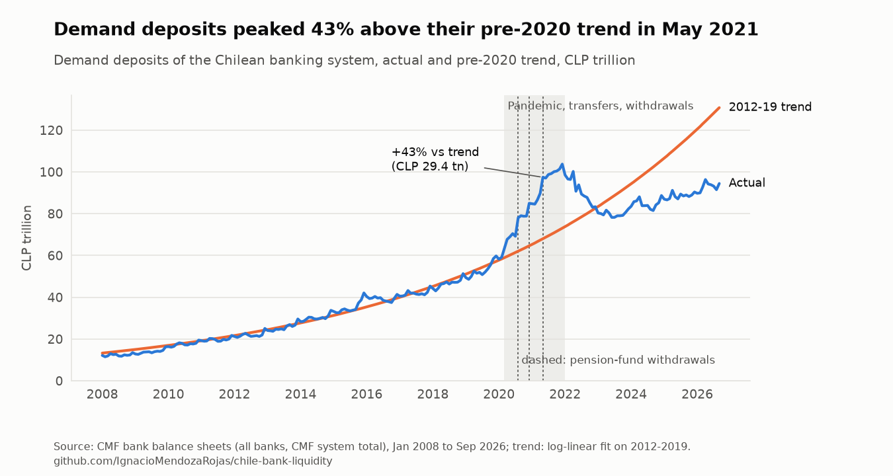
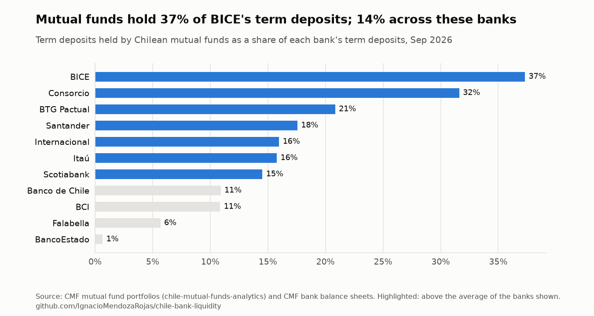
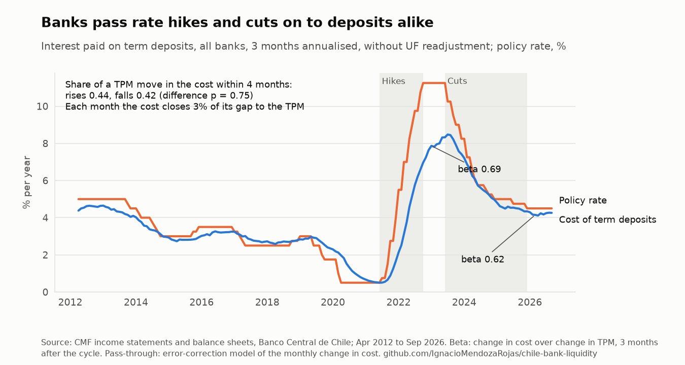
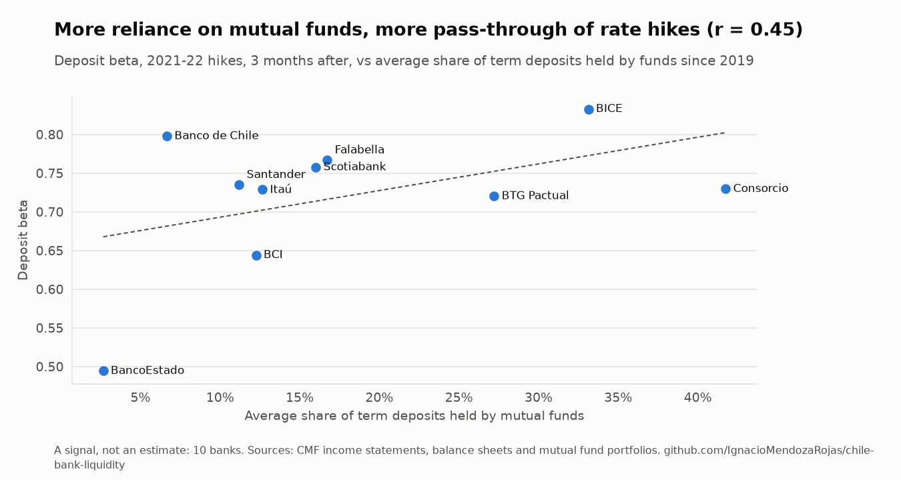

# chile-bank-liquidity

[](https://github.com/IgnacioMendozaRojas/chile-bank-liquidity/actions/workflows/ci.yml)
[](https://github.com/IgnacioMendozaRojas/chile-bank-liquidity/actions/workflows/data.yml)
[](https://github.com/IgnacioMendozaRojas/chile-bank-liquidity/actions/workflows/model.yml)

**Liquidity risk: deposit stability, stress outflows, deposit forecasting and the cost of funding.** Every Chilean bank's balance sheet and income statement since 2008, from the CMF API, used to answer the questions a liquidity-risk team answers for its own bank: how much of the deposit base is stable, how much could leave under stress, how well balances can be forecast, who provides the funding, and how fast a rate move reaches its cost.

*Personal analysis of public CMF and Banco Central de Chile data. Not investment advice. The views are my own and not those of my employer.*

## Results

*Every number in the text below is computed from the data and rewritten by the monthly workflow; none is typed by hand.*

- **The pandemic surge was not stable money.** Demand deposits peaked <!--x:surge_pct-->43%<!--/x--> above their pre-2020 trend in <!--x:surge_month-->May 2021<!--/x--> (CLP <!--x:surge_tn-->29<!--/x--> trillion of excess), helped by the pension-fund withdrawals. The system's worst 12-month outflow of demand deposits came after it, in <!--x:sys_demand_worst12_year-->2022<!--/x-->, when rate hikes pulled money into term deposits: <!--x:sys_demand_worst12-->20%<!--/x-->; for <!--x:banks_hikes_n-->8<!--/x--> of the ten largest banks the worst came in the same <!--x:banks_hikes_years-->2022-23<!--/x--> episode, from <!--x:banks_hikes_range-->21% to 35%<!--/x-->.
- **<!--x:forecast_headline-->No forecasting model is reliably better than a simple one<!--/x-->.** Out of sample since 2014, damped seasonal exponential smoothing misses demand deposits by a median <!--x:ets12-->6.6%<!--/x--> at 12 months (system and ten banks), against <!--x:sarimax12-->9.0%<!--/x--> for SARIMAX with the policy rate and <!--x:rw12-->10.1%<!--/x--> for a random walk, <!--x:forecast_verdict-->but the difference with SARIMAX is not statistically significant<!--/x--> (p = <!--x:dm_sarimax_p-->0.85<!--/x-->). No model anticipated 2020-21: errors reach <!--x:pandemic12_range-->23% to 25%<!--/x--> in windows that touch it.
- **Funding from mutual funds is concentrated and rate-sensitive; pass-through is not asymmetric.** Mutual funds hold <!--x:fund_share-->14%<!--/x--> of the term deposits of the <!--x:fund_banks-->11<!--/x--> banks they invest in (<!--x:fund_max-->37%<!--/x--> at <!--x:fund_max_bank-->BICE<!--/x-->) and withdrew <!--x:fund_outflow12-->63%<!--/x--> of their bank deposits in 12 months in 2021-22. <!--x:cost_headline-->Banks pass rate hikes and cuts on to deposits alike<!--/x-->: within <!--x:pass_lags-->4<!--/x--> months, <!--x:pass_up-->0.44<!--/x--> of a rise in the TPM and <!--x:pass_down-->0.42<!--/x--> of a fall reach the cost of term deposits (difference p = <!--x:pass_p-->0.75<!--/x-->). What differs between cycles is how far the cost still is from the policy rate when a cycle ends.

<picture>
  <source media="(prefers-color-scheme: dark)" srcset="docs/figures/surge-dark.png">
  
</picture>

## What this shows

| Task in a liquidity-risk team | Where it is done here |
|---|---|
| Build a clean monthly history from regulatory data | CMF API, both charts of accounts (2008-2021 and 2022+) mapped to one set of items ([`accounts.py`](src/liquidity/accounts.py), [`data.py`](src/liquidity/data.py)) |
| Reconcile against an independent source | Sum of banks vs the CMF system total (matches to 0.0% since November 2009); monthly growth vs the Banco Central monetary aggregates, whose definitions differ in level ([`checks.py`](src/liquidity/checks.py)) |
| Handle mergers in time series | Mergers detected from the data and folded into pro-forma histories (Corpbanca into Itaú, BBVA into Scotiabank, Security into BICE) |
| Calibrate run-off and the stable core of deposits | Worst and 99% outflows at 1, 3 and 12 months, core deposits, decay curves and half-lives, with and without the pandemic ([`deposits.py`](src/liquidity/deposits.py)) |
| Backtest a stress calibration | Outflows calibrated to 2019 and to 2021, checked against what happened next |
| Forecast balances and judge the model honestly | SARIMAX with the policy rate, month effects and event interventions, against exponential smoothing and a random walk, rolling origin ([`forecast.py`](src/liquidity/forecast.py)) |
| Measure funding concentration and its run-off | Mutual-fund deposits by bank from [chile-mutual-funds-analytics](https://github.com/IgnacioMendozaRojas/chile-mutual-funds-analytics), stressed at the funds' observed outflows ([`funding.py`](src/liquidity/funding.py)) |
| Measure the deposit beta | Interest cost of deposits from income statements, rate cycles found in the TPM, beta per cycle and bank, and an error-correction model that separates pass-through from the pull towards the policy rate ([`cost.py`](src/liquidity/cost.py)) |
| Keep it current without manual work | Monthly workflows download, recompute, redraw the figures and rewrite every number in this README; publication stops if a check fails ([`validate.py`](src/liquidity/validate.py)) |

## Latest reading

<!-- latest:start -->
**Latest reading: September 2026.** Banks held CLP 94.5 trillion of demand and CLP 132.2 trillion of term deposits in September 2026; mutual funds held 14% of the term deposits of the 11 banks they invest in. Banks pass rate hikes and cuts on to deposits alike; what differs is how far deposit costs are from the policy rate when a cycle ends.

| Indicator | Latest | Month before | Change | Note |
|---|---:|---:|---:|---|
| Demand deposits, all banks | CLP 94.5 tn | CLP 91.5 tn | +3.2% |  |
| Term deposits, all banks | CLP 132.2 tn | CLP 130.7 tn | +1.1% |  |
| Share of term deposits held by mutual funds (banks they invest in) | 14.1% | 14.6% | -0.5 pp |  |
| Cost of term deposits, all banks | 4.3% | 4.3% | -0.0 pp |  |
| Policy rate (TPM), month end | 4.5% | 4.5% | +0.0 pp |  |

*Updated automatically on 2026-11-24 from the CMF and Banco Central. CLP tn = CLP trillion (10^12). A note gives the month when an indicator lags the others.*
<!-- latest:end -->

## Findings

**1. Deposit stability.** Over 2008-2026, the system kept <!--x:core_demand-->79%<!--/x--> of its demand deposits and <!--x:core_term-->74%<!--/x--> of its term deposits through the worst 12 months on record (the stable core). Fitting an exponential decay to those stress outflows at 1 to 24 months and extrapolating it gives half-lives of about <!--x:half_life_demand-->44<!--/x--> and <!--x:half_life_term-->38<!--/x--> months; this is a summary of the stress curve, not a measured life of deposit cohorts. Term deposits ran hardest in <!--x:sys_term_worst12_years-->2020-21<!--/x--> (<!--x:sys_term_worst12-->26%<!--/x--> in 12 months, during COVID and the withdrawals); demand deposits in <!--x:sys_demand_worst12_year-->2022<!--/x--> (<!--x:sys_demand_worst12-->20%<!--/x-->), as rates rose. Taking the pandemic out lowers the 12-month term stress outflow from <!--x:sys_term_worst12-->26%<!--/x--> to <!--x:sys_term_stress_ex_pandemic-->14%<!--/x-->, which is why the window is treated as a structural break rather than averaged in.

<picture>
  <source media="(prefers-color-scheme: dark)" srcset="docs/figures/outflows-dark.png">
  
</picture>

**2. Backtesting the stress calibration.** Calibrated on data up to 2019, the stress outflows covered what happened next in only <!--x:bt2019_term-->39%<!--/x--> of term-deposit and <!--x:bt2019_demand-->42%<!--/x--> of demand-deposit cases (system and banks, three horizons): 2020-22 was outside the history. Recalibrated with data to 2021, they cover <!--x:bt2021_term-->100%<!--/x--> of term-deposit cases and <!--x:bt2021_total-->85%<!--/x--> of total-deposit cases, but still only <!--x:bt2021_demand-->42%<!--/x--> for demand deposits, whose 2022-23 outflow was the unwinding of the surge itself.

**3. Forecasting.** SARIMAX on log balances with the policy rate, month dummies, a level shift at each pension-fund withdrawal and a pandemic box explains the history: a 1-point rise in the TPM moves system term deposits up <!--x:tpm_term_effect-->1.2%<!--/x--> (standard error <!--x:tpm_term_se-->0.5<!--/x--> points) and the first and third withdrawals raised demand deposits <!--x:withdrawal1-->12%<!--/x--> and <!--x:withdrawal3-->10%<!--/x-->. As a forecaster it is not better than exponential smoothing for demand deposits, even though it is told the future policy rate (a conditional forecast) and the benchmarks are not. <!--x:term_forecast_note-->For term deposits no model wins at every horizon (best at 1, 3, 6 and 12 months: Random walk, Random walk, Random walk, ETS)<!--/x-->. Differences are tested with a Diebold-Mariano-type test, clustered by forecast origin ([`forecast_compare.csv`](data/processed/forecast_compare.csv)); the ARIMA order is chosen with data up to the first forecast origin only.

<picture>
  <source media="(prefers-color-scheme: dark)" srcset="docs/figures/forecast-dark.png">
  
</picture>

**4. Who funds the banks.** Mutual funds' deposits are matched to each bank's term deposits, for the <!--x:fund_banks-->11<!--/x--> banks the funds invest in (about 98% of the system's term deposits). The share ranges from <!--x:fund_min-->1%<!--/x--> at <!--x:fund_min_bank-->BancoEstado<!--/x--> to <!--x:fund_max-->37%<!--/x--> at <!--x:fund_max_bank-->BICE<!--/x-->. Across these banks it fell from <!--x:fund_peak-->21%<!--/x--> in <!--x:fund_peak_month-->April 2020<!--/x--> to <!--x:fund_trough-->6%<!--/x--> in <!--x:fund_trough_month-->February 2022<!--/x--> and was <!--x:fund_share-->14%<!--/x--> in <!--x:fund_share_month-->September 2026<!--/x-->. Applying the funds' own worst outflows (<!--x:fund_outflow1-->25%<!--/x--> in a month, <!--x:fund_outflow3-->45%<!--/x--> in three, <!--x:fund_outflow12-->63%<!--/x--> in twelve) gives each bank's exposure to a run by this single type of depositor.

<picture>
  <source media="(prefers-color-scheme: dark)" srcset="docs/figures/fund-share-dark.png">
  
</picture>

**5. The cost of funding.** The cost of term deposits is the interest paid over the last three months, annualised, over the average balance, without the UF readjustment (which follows inflation, not the policy rate). Rate cycles are found in the month-end TPM. Measured as a cycle beta, the system's cost had risen <!--x:beta_hike0-->0.60<!--/x--> points per point of TPM at the last hike of <!--x:hike_years-->2021-22<!--/x--> (TPM <!--x:hike_tpm-->+10.75<!--/x--> points) and <!--x:beta_hike3-->0.69<!--/x--> three months later; in the <!--x:cut_years-->2023-25<!--/x--> cuts (TPM <!--x:cut_tpm-->-6.75<!--/x--> points) it had fallen <!--x:beta_cut0-->0.59<!--/x--> at the last cut and <!--x:beta_cut3-->0.62<!--/x--> three months later. That gap after the cycle is not evidence that cuts are passed on less: when the hikes ended the cost was <!--x:gap_end_hikes-->4.3<!--/x--> points below the TPM and kept repricing towards it, while when the cuts ended it was only <!--x:gap_end_cuts-->0.2<!--/x--> points below. An error-correction model of the monthly change in cost separates the two: within <!--x:pass_lags-->4<!--/x--> months, <!--x:pass_up-->0.44<!--/x--> of a rise and <!--x:pass_down-->0.42<!--/x--> of a fall in the TPM reach the cost (difference p = <!--x:pass_p-->0.75<!--/x-->), and each month the cost closes <!--x:gap_closed-->3%<!--/x--> of its gap to the TPM. Bank by bank, <!--x:spread_banks_sig-->0<!--/x--> of <!--x:spread_banks-->10<!--/x--> banks show a significant difference and <!--x:spread_banks_up-->5<!--/x--> pass on more of the rises ([`cost_spread_model.csv`](data/processed/cost_spread_model.csv)). Earlier cuts (2013-14, 2016-17, 2019-20) had cycle betas of <!--x:earlier_cuts_range-->0.48 to 0.66<!--/x-->. Across the <!--x:corr_banks-->10<!--/x--> banks, reliance on mutual funds goes with more pass-through of the <!--x:hike_years-->2021-22<!--/x--> hikes (correlation <!--x:corr_hike-->0.45<!--/x-->) and less clearly with the cuts (<!--x:corr_cut-->0.23<!--/x-->).

<picture>
  <source media="(prefers-color-scheme: dark)" srcset="docs/figures/cost-dark.png">
  
</picture>

<picture>
  <source media="(prefers-color-scheme: dark)" srcset="docs/figures/beta-vs-funds-dark.png">
  
</picture>

## Caveats

- Balance-sheet data are a proxy for liquidity: there is no maturity ladder, no split by depositor type and no LCR inflow and outflow categories in public data.
- Bank-level figures cover the ten largest banks today, chosen with hindsight: banks that left the market (Banco del Desarrollo, Penta, Rabobank and others) are only in the system totals.
- BTG Pactual and Consorcio have short, fast-growing deposit histories, so their stress outflows and trends say little.
- Being below the 2012-2019 trend is not a deficit: the trend is an extrapolation of a period of <!--x:trend_growth-->13%<!--/x--> annual growth.
- Banco del Desarrollo (2009) leaves the data without a matched acquirer and is not folded into any bank.
- Bank-level tests use 10 banks that face the same rate shock, so they are not independent observations; the beta-funds correlation is a signal, not an estimate.
- The mutual-fund share covers the banks the funds invest in, not the whole system.
- Before 2012 the CMF reports interest and UF readjustment together; betas of those cycles are flagged and not compared with later ones.
- The CMF API allows 10,000 requests a month per key, and a few statements fail on the API every time (for example Banco de Chile, July 2023); those are read from the CMF's monthly text files instead ([`textfiles.py`](src/liquidity/textfiles.py)), which give the same figures ([`test_cmf_statements.py`](tests/test_cmf_statements.py)).

## Data and automation

- Sources: CMF API (SBIF v3) balance sheets and income statements by bank; Banco Central de Chile (SIETE API) policy rate, Central Bank bond yields and monetary aggregates; mutual-fund holdings from [chile-mutual-funds-analytics](https://github.com/IgnacioMendozaRojas/chile-mutual-funds-analytics). Events and the pandemic window are listed with their sources in [`config/events.yaml`](config/events.yaml). What each run read (dates, the fund file's hash and commit) is in [`sources.json`](data/processed/sources.json) and in `latest.json`.
- [`data.yml`](.github/workflows/data.yml) runs monthly and adds the new month; it resumes where it stopped, re-requests any bank-month that failed, falls back to the CMF's monthly text files when the API keeps failing, and stops at the API's request limit instead of retrying. A normal month uses about 60 of the CMF's 10,000 monthly requests; each run is capped at 3,000. If the income statements cannot be updated the run fails, so no model step runs on stale costs.
- [`model.yml`](.github/workflows/model.yml) then recomputes deposits, funding, cost and forecasts, redraws the figures, rewrites `latest.json`, [`results.json`](results.json) and every number in this README, and runs `liquidity validate` before committing. Publication stops if a number in the README differs from the data; if a month is missing for some banks or an indicator lags; if the sum of banks is more than 0.5% off the CMF system total or monthly growth is more than 5% off the Banco Central aggregate; if a value is out of range; and, until reviewed, if a system aggregate moves more than its monthly limit (10% for deposits, 1 point for the cost, 3 points for the fund share), if published history changes, or if a conclusion in the text flips. A reviewed change is published by running the workflow by hand with `accept_changes`.
- Results are in [`data/processed`](data/processed) as CSV.

## Run it

```bash
pip install -e ".[dev]"
export CMF_API_KEY=...  BCCH_USER=...  BCCH_PASS=...   # only for `liquidity data`
liquidity data        # download new months and run the checks
liquidity deposits    # outflows, stable core, decay, backtests
liquidity funding     # mutual-fund share of term deposits and run-off
liquidity cost        # cost of deposits, deposit betas and the error-correction model
liquidity forecast    # rolling-origin evaluation (about 30 minutes)
liquidity build       # figures, latest.json, results.json and every number in this README
liquidity validate    # the checks that must pass before publishing
pytest && ruff check .
```

MIT licence. Built by [Ignacio Mendoza Rojas](https://www.linkedin.com/in/ignaciomendozarojas/). Personal analysis of public data; not investment advice; the views are my own and not those of my employer.
